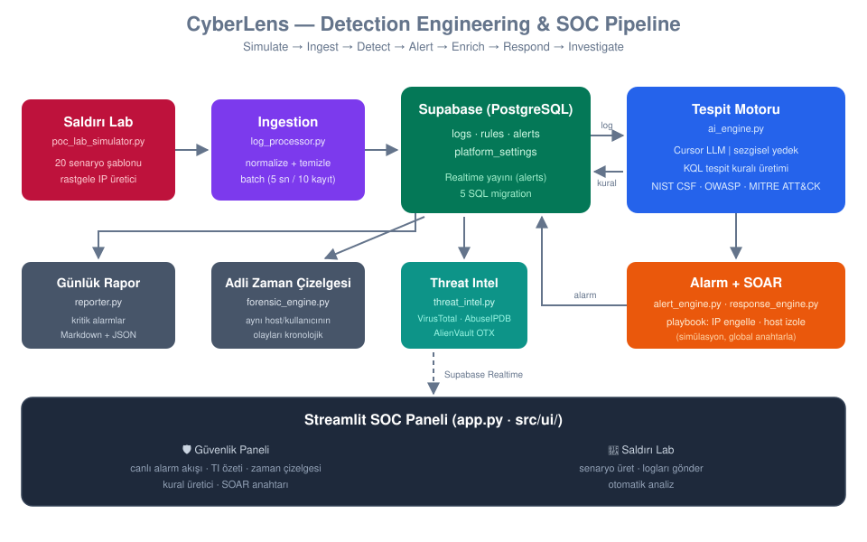

# 🛡️ CyberLens — Tespit Mühendisliği & SOC Otomasyon Platformu


**Python + Supabase** ile geliştirilmiş, bir SOC iş akışını uçtan uca taklit eden
tespit mühendisliği laboratuvarı: saldırı loglarını toplar, tehditleri tespit edip
**KQL tespit kuralı** üretir, bulguları **MITRE ATT&CK / NIST CSF / OWASP** ile
eşler, IoC'leri **VirusTotal · AbuseIPDB · AlienVault OTX** ile zenginleştirir,
saldırganın hareketlerinden **olay zaman çizelgesi** çıkarır ve isteğe bağlı olarak
**SOAR playbook**'u çalıştırır.

> **Kısaca:** Saldırı Lab sahte saldırı logu üretir → sistem tehdidi yakalar →
> kural + alarm oluşturur → panelde canlı izlersin → istersen otomatik müdahale eder.

## ✨ Öne Çıkanlar

- 🔍 **Tespit motoru:** Cursor LLM ile log analizi; anahtar yoksa **sezgisel (rule-based) motor** — her iki durumda da Microsoft Sentinel uyumlu **KQL** sorgusu üretilir
- 🎯 **Framework eşlemesi:** her kural `NIST:DE.AE; OWASP:A07:2021; MITRE:T1003` biçiminde etiketlenir
- 🛰 **Çoklu kaynak IoC zenginleştirme:** VirusTotal (%45) + AbuseIPDB (%35) + OTX (%20) → 1–10 arası **ağırlıklı risk skoru** ve KRİTİK işaretleme
- ⚡ **SOAR:** tek bir global anahtarla 9 olay türü için playbook (IP engelle · host izole · kullanıcı kapat · process karantina)
- 🕓 **Adli zaman çizelgesi:** bir alarmın host/kullanıcısına ait tüm olayları kronolojik dizer
- 📊 **Canlı SOC paneli:** Supabase Realtime (WebSocket, bağlantı yoksa 2 sn polling) ile anlık alarm akışı
- 🧪 **Saldırı Lab:** 12 olay türünde 20 saldırı senaryosu + zararlı/zararsız/iç ağ IP üretici
- 📑 **Günlük rapor:** kritik alarmların Markdown + JSON özeti
- ✅ **GitHub Actions CI:** ruff lint + 27 birim testi (Supabase/API anahtarı gerektirmez)

## 🧱 Mimari



<details>
<summary>ASCII diyagram (metin)</summary>

```
 ┌──────────────┐   ┌──────────────┐   ┌──────────────────┐   ┌───────────────────┐
 │ Saldırı Lab  │──▶│ log_processor│──▶│    Supabase      │──▶│    ai_engine      │
 │ (20 senaryo) │   │ normalize +  │   │ logs·rules·alerts│◀──│ LLM | sezgisel    │
 └──────────────┘   │ batch        │   │ platform_settings│   │ KQL + MITRE/NIST  │
                    └──────────────┘   └────────┬─────────┘   └─────────┬─────────┘
                                                │                       ▼
        ┌───────────────┬───────────────────────┤             ┌───────────────────┐
        ▼               ▼                       ▼             │ alert_engine +    │
  reporter.py    forensic_engine.py      threat_intel.py      │ response_engine   │
  (günlük rapor) (zaman çizelgesi)       (VT·AbuseIPDB·OTX)   │ (SOAR playbook)   │
        └───────────────┴──────────┬────────────┘             └───────────────────┘
                                   ▼
                  Streamlit SOC Paneli (Realtime alarm akışı)
```

</details>

## 📸 Ekran Görüntüleri

> Ekran görüntüleri `docs/screenshots/` klasörüne eklenecek — bkz. [docs/screenshots/README.md](docs/screenshots/README.md).

<!--


-->

## ⚙️ Bileşenler

| Katman | Modül | Sorumluluk |
| --- | --- | --- |
| Ingestion | `src/log_processor.py` | Alan eşleme, temizleme (null byte, uzunluk), batch buffer (5 sn / 10 kayıt) |
| Persistence | `src/database.py` | Supabase CRUD — logs, rules, alerts, platform_settings |
| Detection | `src/ai_engine.py` | LLM / sezgisel tehdit analizi, KQL üretimi, NIST/OWASP/MITRE eşlemesi |
| Alerting | `src/alert_engine.py` | Kural sonrası otomatik alarm (log başına tekil) |
| SOAR | `src/response_engine.py` | Olay türüne göre playbook (simülasyon) |
| Threat Intel | `src/threat_intel.py` | IoC çıkarma + çoklu kaynak ağırlıklı skor |
| Forensics | `src/forensic_engine.py` | Saldırgan zaman çizelgesi rekonstrüksiyonu |
| Orchestration | `src/pipeline.py` | Ingest → analyze → alert → report |
| Reporting | `src/reporter.py` | Günlük kritik alarm raporu (MD + JSON) |
| UI | `app.py`, `src/ui/` | Streamlit çok sayfalı panel |

## 🔁 Tespit Akışı

1. **Ingest** — log `log_processor` ile normalize edilip `logs` tablosuna yazılır
2. **Analiz** — `ai_engine` logu inceler (Cursor LLM veya sezgisel motor)
3. **Kural** — tehdit varsa KQL sorgusu + framework etiketleriyle `rules` tablosuna kaydedilir
4. **Alarm** — `alert_engine` önem derecesiyle alarm üretir; Realtime ile panele düşer
5. **Zenginleştirme** — panel, alarmın IoC'lerini `threat_intel` ile puanlar
6. **Müdahale** — SOAR anahtarı açıksa playbook çalışır, alarm `investigating` durumuna geçer
7. **İnceleme** — analist adli zaman çizelgesinde saldırganın diğer hareketlerini görür

Örnek sezgisel KQL çıktısı:

```kql
SecurityEvent
| where TimeGenerated > ago(24h)
| where EventID in (4688, 4624, 4625, 4648)
| where Computer has "LAB-DC01" or Account has "admin"
| where Process has "credential" or CommandLine has "credential"
| project TimeGenerated, Computer, Account, EventID, Process, CommandLine
| order by TimeGenerated desc
```

## 🛰 Tehdit İstihbaratı

`get_threat_score(ip)` üç kaynağı sorgular, her birini 1–10'a normalize eder ve ağırlıklı ortalama alır:

| Kaynak | Ağırlık | Normalizasyon |
| --- | --- | --- |
| VirusTotal | %45 | zararlı + ½·şüpheli motor oranı |
| AbuseIPDB | %35 | abuse confidence score |
| AlienVault OTX | %20 | pulse sayısı (10+ = maksimum) |

- **KRİTİK** koşulu: VirusTotal'da en az bir motor `malicious` **veya** AbuseIPDB skoru ≥ %50
- Ağırlıklar `.env` içinden (`TI_WEIGHT_*`) değiştirilebilir
- Özel/iç ağ IP'leri dış kaynaklara sorgulanmaz
- API anahtarı yoksa **offline mod**: yerleşik bilinen-zararlı IP / blok listesiyle demo skoru üretilir
- Canlı API sorgusu IP'ler içindir; domain ve dosya IoC'leri yerleşik listeyle değerlendirilir

## ⚡ SOAR — Otomatik Müdahale

Panelin sol menüsündeki anahtar (`platform_settings.global_policy`) açıkken tehdit
alarmları analist onayı beklemeden işlenir:

| Olay türü | Playbook |
| --- | --- |
| `lateral_movement` | IP engelle · host izole · SOC bildir |
| `credential_access` | kullanıcı devre dışı · parola sıfırla · host izole |
| `powershell_execution` | process karantina · host izole |
| `data_exfiltration` | IP engelle · host izole · SOC bildir |
| `command_and_control`, `malware_download`, `phishing`, … | toplam 9 olay türü, diğerleri için varsayılan playbook |

> Aksiyonlar **simülasyondur** (gerçek firewall/EDR'a bağlı değildir); playbook mantığını ve
> alarm yaşam döngüsünü gösterir. Logda geçerli bir IP veya process bilgisi yoksa ilgili
> aksiyon uydurulmaz, "atlandı" olarak kaydedilir.

## 🚀 Hızlı Başlangıç

**Gereksinimler:** Python 3.11+, ücretsiz bir [Supabase](https://supabase.com) projesi.

```bash
git clone https://github.com/RabiaTorlak/CyberLens.git
cd CyberLens
python -m venv .venv
# Windows: .venv\Scripts\activate   ·   Linux/macOS: source .venv/bin/activate
pip install -r requirements.txt
cp .env.example .env               # değerleri doldur
```

| Değişken | Gerekli | Açıklama |
| --- | --- | --- |
| `SUPABASE_URL` | ✅ | Supabase proje URL'si |
| `SUPABASE_KEY` | ✅ | Anon (publishable) anahtar — sıkılaştırma sonrası service_role |
| `SUPABASE_DB_PASSWORD` | ⭕ | Yalnızca `scripts/apply_schema.py` için |
| `CURSOR_API_KEY` | ⭕ | LLM analizi (yoksa sezgisel motor) |
| `VIRUSTOTAL_API_KEY` | ⭕ | Canlı TI (yoksa offline mod) |
| `ABUSEIPDB_API_KEY` | ⭕ | Canlı TI (yoksa offline mod) |
| `OTX_API_KEY` | ⭕ | Canlı TI (yoksa offline mod) |

```bash
python scripts/apply_schema.py                     # 1) migration'ları uygula
python scripts/health_check.py                     # 2) sağlık kontrolü
python lab/poc_lab_simulator.py --count 6 --full   # 3) saldırı logu gönder + analiz et
streamlit run app.py                               # 4) paneli aç
python -m src.reporter                             # 5) günlük kritik alarm raporu
```

Opsiyonel anahtarlar olmadan da platform çalışır: sezgisel tespit ve offline tehdit istihbaratı devreye girer.

## ✅ Testler

```bash
pip install -r requirements-dev.txt
ruff check .
pytest -q
```

Testler; tehdit skoru ve KRİTİK mantığı, IoC çıkarma, sezgisel tespit + KQL üretimi
(KQL kaçışı dahil), LLM yanıt ayrıştırma, SOAR playbook seçimi ve log normalizasyonunu
kapsar. Supabase ve dış API çağrıları test sırasında devre dışıdır.

## 📁 Proje Yapısı

```
CyberLens/
├── app.py                      # Streamlit giriş noktası (2 sayfa)
├── config.py                   # Ortam değişkenleri
├── src/
│   ├── log_processor.py        # Normalize + batch ingestion
│   ├── database.py             # Supabase veri erişimi
│   ├── ai_engine.py            # LLM / sezgisel tespit + KQL
│   ├── alert_engine.py         # Otomatik alarm
│   ├── response_engine.py      # SOAR playbook
│   ├── threat_intel.py         # VT + AbuseIPDB + OTX skorlama
│   ├── forensic_engine.py      # Adli zaman çizelgesi
│   ├── realtime_listener.py    # Supabase Realtime + polling yedeği
│   ├── pipeline.py             # Uçtan uca orkestrasyon
│   ├── reporter.py             # Günlük rapor
│   └── ui/                     # Panel sayfaları ve tema
├── lab/poc_lab_simulator.py    # Saldırı senaryoları + IP üretici
├── scripts/                    # apply_schema, health_check, run_pipeline, set_cursor_key
├── supabase/
│   ├── migrations/             # 001–005 PostgreSQL şeması
│   └── hardening/              # İsteğe bağlı RLS sıkılaştırma
├── tests/                      # pytest birim testleri
├── docs/                       # Mimari diyagram + ekran görüntüleri
└── .github/workflows/ci.yml    # Lint + test
```

## 🔒 Güvenlik Notları

- Tüm kimlik bilgileri `.env` üzerinden okunur; `.env` `.gitignore` içindedir ve repoya commit edilmez.
- **RLS:** Tablolarda Row Level Security açıktır, ancak varsayılan lab şeması kolaylık için
  **"herkese izin ver"** (`USING (TRUE)`) politikaları kullanır — yani anon anahtarına sahip herkes
  verileri okuyup yazabilir. Paylaşılan veya kalıcı bir ortamda
  [`supabase/hardening/rls_lockdown.sql`](supabase/hardening/rls_lockdown.sql) uygulanmalı ve
  uygulama sunucu tarafında service_role anahtarıyla çalıştırılmalıdır.
- Sezgisel motorun ürettiği KQL'e gömülen host/kullanıcı değerleri kaçışlanır.
- SOAR aksiyonları simülasyondur; gerçek altyapıya bağlamadan önce onay akışı ve yetkilendirme eklenmelidir.

## ⚠️ Yasal Uyarı

Bu proje **eğitim ve laboratuvar** amaçlıdır. Saldırı Lab yalnızca sahte log üretir;
gerçek sistemlere karşı hiçbir saldırı gerçekleştirmez. Tehdit istihbaratı API'lerini
ilgili servislerin kullanım koşullarına uygun şekilde kullanın.

## 📜 Lisans

[MIT](LICENSE) © 2026 Rabia Torlak
